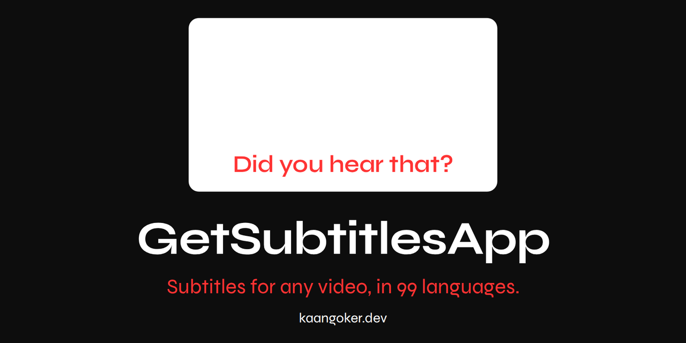
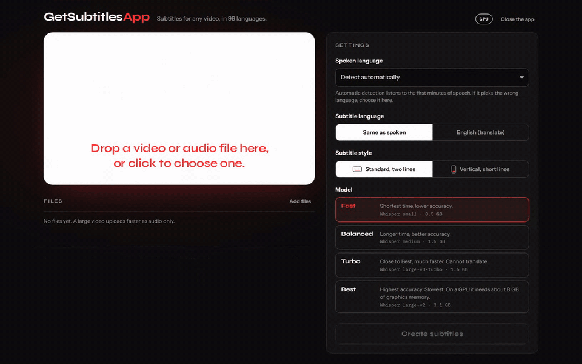
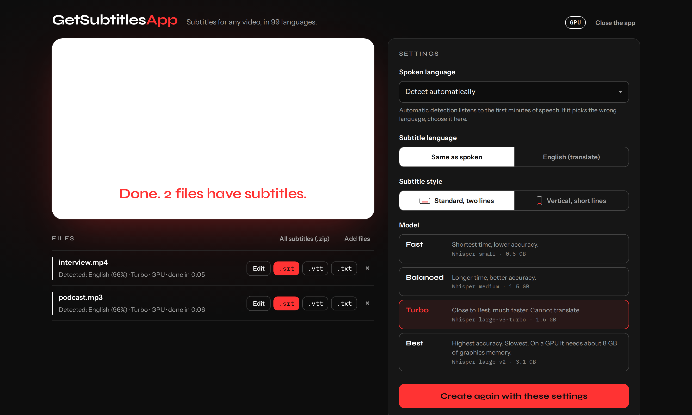
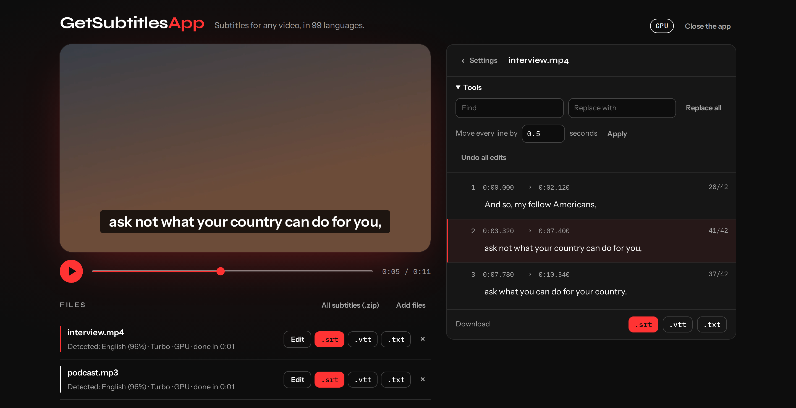

# GetSubtitlesApp

[](https://huggingface.co/spaces/KaanGoker/GetSubtitlesApp)
[](https://github.com/KaanGoker/GetSubtitlesApp/tree/main?tab=License-1-ov-file)

Subtitles for any video, in 99 languages, on your own computer.

<p align="center">
  
</p>

<h3 align="center">
  <a href="https://huggingface.co/spaces/KaanGoker/GetSubtitlesApp" target="_blank">Try the demo on Hugging Face</a>
  &nbsp;·&nbsp;
  <a href="https://github.com/KaanGoker/GetSubtitlesApp/releases/latest">Download for Windows, Linux and macOS</a>
</h3>

---

**GetSubtitles** makes subtitles for video and audio files in 99 languages. It can also translate the speech from any of those languages into English subtitles. It runs on OpenAI's Whisper model, through faster-whisper.

It has a **mode for vertical videos**, with the short single lines that Instagram Reels, YouTube Shorts and TikTok need.

**The problem.** Video editors offer automatic subtitles, but often only for English and a few other big languages. For anyone working in a less common language, subtitles are still slow, manual work.

**What it does.** You drop in a file, the app writes the subtitles, you fix them in the editor and download a `.srt` file. Everything runs on your computer.

<p align="center"></p>

<p align="center">
  
</p>

<p align="center">
  
</p>

---

## Features

-   **Language**: The app detects the spoken language from up to two minutes of speech, so a video that opens with music still gets the right language. When it gets it wrong, you choose the language yourself.
-   **Transcription and translation**: Subtitles in the spoken language, or translated into English.
-   **Audio tracks**: When a video has more than one audio track, you choose the one to transcribe.
-   **Four models**: `Fast`, `Balanced`, `Turbo` and `Best`, from the quickest to the most accurate. The page shows the Whisper model behind each one and its size.
-   **Subtitle styles**: Standard `16:9` videos get up to two lines of 42 characters. Vertical `9:16` videos get single lines of at most 38 characters.
-   **Editor**: Check the subtitles on the video and fix them in the app. Change the text and the times, split or join lines, find and replace a misheard name, move every line earlier or later.
-   **Formats**: Download the result as `.srt`, `.vtt` or `.txt`.
-   **Several files**: Add several files at once. They run one after another, and you can download all the subtitles as one `.zip`.
-   **Silence filter**: Parts without speech are skipped, so music and silence produce less invented text.
-   **Large files**: Files up to 8 GB are written straight to disk, so a long video does not fill the memory.
-   **GPU**: On Windows and Linux with an NVIDIA graphics card, one button downloads the GPU support and the models run on the card.
-   **Download progress**: Model and GPU support downloads show their progress in percent.
-   **Cross platform**: One file to download for Windows, Linux and macOS, with `ffmpeg` inside. Docker works too.

---

## Usage

### Windows

1.  **Download**: Go to the [Releases](https://github.com/KaanGoker/GetSubtitlesApp/releases) page and download `GetSubtitlesApp.zip` from the latest release.
2.  **Extract**: Unzip it into a new folder.
3.  **Run**: Double-click `GetSubtitles.exe`. The app opens in your web browser.

Windows may show "Windows protected your PC" the first time. The exe is not code signed, so Windows does not know who made it. Click **More info**, then **Run anyway**.

The app closes itself about a minute after you close its browser tab. The **Close the app** button at the top of the page closes it right away.

### Linux

1.  Download `GetSubtitles-linux-x64.tar.gz` from the [latest release](https://github.com/KaanGoker/GetSubtitlesApp/releases/latest) and unpack it.
2.  Run `./GetSubtitles`. The app opens in your web browser.

It was built on Ubuntu 22.04 and runs on that and newer x64 systems.

### macOS (Apple Silicon)

1.  Download `GetSubtitles-macos-arm64.zip` from the [latest release](https://github.com/KaanGoker/GetSubtitlesApp/releases/latest) and unzip it.
2.  Open `GetSubtitles.app`. The app opens in your web browser.

The app is not signed by Apple, so macOS blocks it the first time. Open **System Settings**, then **Privacy & Security**, and click **Open Anyway** next to the message about GetSubtitles. On a Mac the models run on the processor; Fast, Balanced and Turbo are the practical choices. The macOS build passes an automatic test with a real file on every release, but it has not been tried by hand yet. If something goes wrong, please open an issue.

### On every system

**First run**: The app downloads a model the first time you use it, so it needs an internet connection then. Each model is downloaded once:

| Model | Whisper model | Size |
| --- | --- | --- |
| Fast | small | 0.5 GB |
| Balanced | medium | 1.5 GB |
| Turbo | large-v3-turbo | 1.6 GB |
| Best | large-v2 | 3.1 GB |

Turbo cannot translate, so a translation chosen with Turbo runs on Best.

Best is heavy. On a GPU it needs about 8 GB of graphics memory; on the processor it is slow. With a smaller card, use Turbo or Balanced.

**NVIDIA GPU (Windows and Linux)**: The app runs on the processor at first. When your PC has an NVIDIA graphics card, the page offers **Download GPU support** under the models. It downloads cuBLAS 12 and cuDNN 9 from PyPI, about 1.2 GB, once, and checks each file against its checksum. On disk it takes about 1.9 GB. After that the models run on the graphics card.

**Storage**: The models, the GPU support and the log are kept in `%LOCALAPPDATA%\GetSubtitles` on Windows, `~/.local/share/GetSubtitles` on Linux and `~/Library/Application Support/GetSubtitles` on macOS. The bottom of the page shows the folder, and **Open the folder** opens it. Delete the folder to free the space; the app downloads a model again when it needs it.

## For developers

### 1. Running from source

To work on the app or run it from the source code without Docker:

1.  **Clone the repository**:
    ```bash
    git clone https://github.com/KaanGoker/GetSubtitlesApp.git
    cd GetSubtitlesApp
    ```

2.  **Set up your environment**:
    Use a Python virtual environment and install the dependencies. You also need `ffmpeg` on your PATH.
    ```bash
    pip install -r requirements.txt
    ```

3.  **Run the app**:
    ```bash
    python launcher.py
    ```
    The app starts and opens in your web browser.

    **NVIDIA GPU (optional)**: Install the CUDA libraries in the same environment and the app uses the GPU on its own. Without them it runs on the CPU.
    ```bash
    pip install nvidia-cublas-cu12 "nvidia-cudnn-cu12==9.*"
    ```

4.  **Run the tests**:
    ```bash
    pip install -r requirements-dev.txt
    python -m playwright install chromium
    pytest            # fast tests and the page in a real browser, no model needed
    pytest -m slow    # the whole pipeline with the tiny Whisper model
    ```
    [docs/release-checklist.md](docs/release-checklist.md) lists the checks to do by hand before a release.

---

### 2. Using Docker (macOS, Linux, Windows)

This works on any system with Docker. The container runs the models on the CPU.

1.  Clone the repository:
    ```bash
    git clone https://github.com/KaanGoker/GetSubtitlesApp.git
    cd GetSubtitlesApp
    ```
2.  Build and run:
    ```bash
    docker compose up --build
    ```
3.  Open **`http://localhost:8000`** in your browser.

The models are kept in a Docker volume, so they are downloaded only once.

The app answers only on this computer. To open it to your network, change the port line in `docker-compose.yml` to `"8000:8000"` and add the address you use to `GETSUBTITLES_ALLOWED_HOSTS`.

---

### 3. Building the app

The app is built with **PyInstaller**, on the system it is for:

```bash
pip install pyinstaller imageio-ffmpeg
python build.py
```

The result is `dist/GetSubtitles.exe` on Windows, `dist/GetSubtitles` on Linux and `dist/GetSubtitles.app` on macOS. It holds the app, the page and a static `ffmpeg` (from `imageio-ffmpeg`, or your own build in `bin/`).

`python tools/smoke_app.py dist/GetSubtitles` starts a build, runs one real file through it and closes it.

Pushing a `v*` tag runs `.github/workflows/release.yml`: it builds the three systems on GitHub, runs that test on each, and attaches the files to the release.

---

## How it works

The app is one FastAPI process. It serves its own page, takes the files, runs the jobs and serves the subtitles. The packaged app starts it on a free port and opens the browser.

-   **Upload**: The browser sends the file as a stream and the app writes it to disk. `ffmpeg` lists the audio tracks.
-   **Job**: A job extracts the chosen audio track as 16 kHz mono and gives it to `faster-whisper`. Jobs run one at a time, in the order they were started.
-   **Language**: Whisper detects the language on up to two minutes of speech, not only the first 30 seconds. A language you choose on the page skips the detection.
-   **GPU**: The app looks for cuBLAS 12 and cuDNN 9, from pip or from the GPU support the packaged app downloads on Windows and Linux. When they load, the models run on the GPU. If the GPU fails during a job, the job runs again on the CPU.
-   **Subtitles**: The app builds the subtitle lines from the word times: two lines of at most 42 characters for standard video, single lines of at most 38 characters for vertical video.
-   **Editor**: The page plays the file and shows the line at the playback position. Every edit is saved in the app, and the downloads use the edited lines.
-   **Closing**: The page keeps one connection open. When no page is connected for about a minute and no job is running, the desktop app closes itself.

## Project structure

```
GetSubtitlesApp/
├── app/
│   ├── main.py          the routes: page, uploads, jobs, subtitles, editing, storage, GPU support
│   ├── engine.py        Whisper models: loading, caching, download progress, GPU to CPU fallback
│   ├── gpu.py           GPU support: cuBLAS and cuDNN from PyPI, for Windows and Linux, checked by checksum
│   ├── audio.py         ffmpeg: audio tracks, 16 kHz mono wav
│   ├── subtitles.py     subtitle lines and the .srt, .vtt, .txt writers
│   └── static/          the page: index.html, style.css, app.js, fonts
├── launcher.py          the desktop app: free port, browser, storage folder, closing
├── build.py             builds the app for Windows, Linux or macOS with PyInstaller
├── tools/smoke_app.py   runs one real file through a built app
├── tests/               unit, API, real browser and real model tests
├── docs/release-checklist.md
├── .github/workflows/   tests on every push; builds and attaches the three apps on a release tag
├── Dockerfile           the app in a container
├── Dockerfile.hf        the Hugging Face demo
└── docker-compose.yml
```

---

## Disclaimer and privacy

- **Accuracy**: Whisper makes mistakes, mostly with technical terms, accents and background noise. Check the subtitles before you use them.
- **The Hugging Face demo**: Files are processed on a shared server and deleted from it about an hour after you last used them. The demo counts how many times the page is opened each day; it keeps only that number, with no address, browser or text. **Do not upload sensitive, confidential or personal data** to the demo.
- **The app on your computer**: Your files are processed on your own CPU or GPU and never sent anywhere. The only downloads are the models and, if you ask for it, the GPU support.

## License

This project is licensed under the MIT License. See the LICENSE file for details.

## Acknowledgements

-   OpenAI's Whisper, through faster-whisper.
-   FastAPI and uvicorn.
-   The Syne, Instrument Sans and IBM Plex Mono fonts (SIL Open Font License).
